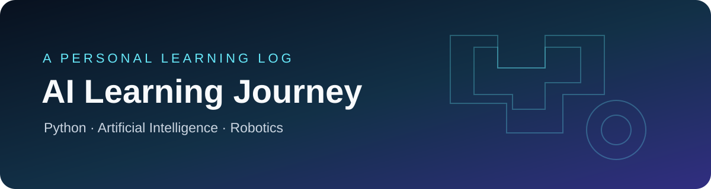

# AI Learning Journey

**A work in progress: learning programming, exploring AI, and building practical projects.**

## 🎯 Mission

Document my progress as I learn how software, AI, and robotics can solve useful problems.

## 🧭 Learning Areas

- **Python** — fundamentals, functions, modules, and small applications
- **Artificial Intelligence** — core concepts and beginner-friendly experiments
- **Robotics** — exploring the connection between code, sensors, and intelligent systems
- **Web Development** — creating and improving useful tools
- **Git & GitHub** — version control, documentation, and project organization

## 🧪 Projects & Experiments

This repository collects learning notes, practice exercises, and small experiments as they are completed.

For each project, I aim to include:
- What the project does
- What I learned
- How to run it
- Screenshots or examples when useful

## 📈 Progress

I’ll update this repository as I complete new topics and build working projects. Items will be marked complete only after I’ve actually finished them.

## 🔗 Explore More

- [My GitHub profile](https://github.com/moeinim351-afk)

---

*Learn by doing. Document the process. Keep improving.*
